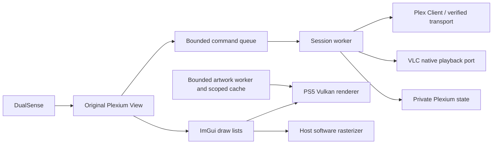

# Full-client feature audit

See [FEATURE-COMPLETION.md](FEATURE-COMPLETION.md) for the current source audit and
[PLAYBACK-CONTRACTS.md](PLAYBACK-CONTRACTS.md) for protocol/platform evidence.
The playback milestone supersedes the earlier direct-play-only checkpoint below: the
actual Session now integrates universal negotiation, version/quality controls,
player observations, scoped progress retry and streaming-session release. Live
PMS and PS5 acceptance remain unrun; named-track renegotiation is incomplete.

# Architecture

The current ownership/teardown contract is recorded in
[GPU-MEDIA-LIFECYCLE.md](GPU-MEDIA-LIFECYCLE.md). It supersedes earlier notes
about device-idle waits, detached player work and deferred video teardown.
Reachable uploads/drains use bounded fences; unresolved workers or presentation
ownership retain their state and produce incomplete shutdown, not success.

Plexium is an independent C++17 application with a new history. The old PlexStation main loop, media browser and ImGui UI were not imported. GPL-compatible protocol helpers and the proven low-level VLC/Vulkan/PS5 substrate were selected explicitly. No Jelly5 implementation, assets or Jellyfin protocols were copied.

Player controls are marshaled through a bounded queue onto the original render thread; worker requests receive the actual control result. A queued operation can expire before execution; an operation already executing completes before its caller proceeds. Stop captures progress before stopping video, and progress requests use a one-second timeout.

`src/app/session.*` owns credentials and selects authorized profiles, servers and sections. `Runtime` serializes commands off the render thread; snapshots contain no authorization tokens. Separate synchronized media context is consumed internally by the native artwork adapter and never serialized/logged. Profile/server changes clear old content and history. Generation changes discard obsolete queued results. Network operations themselves have bounded timeouts; cancellation is cooperative at command boundaries, not socket interruption. Home has a ten-second aggregate budget, short bounded calls, progressive row publication, duplicate-query suppression and a scoped warm cache. Movie/TV/audio sections use server-recommended hubs and 60-item browse pages.

`src/app/view.*` builds the same native draw lists in both targets, with an explicit controller focus model and a single authorized destination registry. Layout draws immediately after state changes. `src/main.cc` integrates DualSense, Vulkan, existing VLC picture upload and timestamped audio; the user reports the original candidate has a correct PS5 home icon, a generally working UI and video playback. The new update has not yet been accepted on hardware. Host rendering runs the actual view, with synthetic metadata and a software rasterizer; it cannot validate the decoder or console GPU.

`src/player.*`, `gfx.*`, platform functions, shader code and PS5 dependency recipes retain their existing licenses. Playback is deliberately limited in this checkpoint to the reused direct-play decision: single-part original H.264/HEVC MP4/MKV. Transcode negotiation, music playback, DVR and Watchlist helpers may exist in the selected protocol source but are not all wired into the new application; individual audio direct play and an experimental direct cloud-TV provider path are now integrated. Do not infer product functionality from those helpers.

Auth uses device linking, validation of the restored primary account, explicit profile selection and protected-profile PIN entry. Only the primary token persists; managed-user tokens are not silently restored past PIN selection. Per-profile server identity preferences are private files and are only selected if returned by current authorized discovery. Identity and library checks must succeed before the server is usable. HTTPS is required by default; HTTP-only personal servers are not enabled in this checkpoint.

The GPU artwork adapter uses a bounded asynchronous decoded-image cache inherited from the stabilization branch. Episode cards explicitly request `grandparent_thumb`, preserving the episode's own `id` for navigation/playback. GPU upload, native transport and artwork sources cross-compile for PS5, but are not exercised by host raster fixtures. Cache scope changes retire old textures. A driver-completion failure disables new uploads and retains uncertain allocations until process teardown.

The original UI and protocols are GPL-3.0-or-later. Future increments should add end-to-end fixture scenarios before expanding routes. Physical firmware 13.40 validation and matching native symbols remain necessary before installation acceptance.

## Rebuild branch bootstrap

Artwork uses three single-job pthread lanes (two media, one avatar), each with
an explicit 1 MiB stack. Cache maintenance shares a media lane. Failed thread
creation keeps the UI alive, reports only an error code, and backs off retries.
Results are polled on the render thread; lane reuse joins the completed thread.
Destruction joins outstanding jobs before releasing callbacks/results. Stacks
and concurrency are bounded; transport/decode/driver completion and physical
stack acceptance remain separate validation requirements.

Personal guide parsing distinguishes explicit empty Plex containers from
malformed provider, lineup and grid shapes. The requested time window is applied
before the 100-program response cap, preventing earlier daily airings from
displacing the visible page. Only actual Plex airings enter the view.

The new `feature/plexium-native-rebuild` branch retains the modules above and adds
an isolated Stage 1 runtime, a checked pthread session worker and a closeable,
bounded render-thread media queue. The native build defaults to startup-only;
full application construction requires `PLEX_STARTUP_ONLY=0`. See
[NATIVE-REBUILD.md](NATIVE-REBUILD.md) for exact scope, limits and hardware gates.

## Full-client feature extension

The current matrix is [FEATURE-COMPLETION.md](FEATURE-COMPLETION.md), superseding the
historical feature gaps above. `app/features.cc` owns the worker-side scoped search,
settings, notices and music queue. `app/view_features.cc` and `app/canvas.h` share the
production native drawing components; no separate frontend is introduced. Heavy
Details/Stop/Tick and feature work use separate worker frames so the existing immediate
startup/dispatch stack limits remain enforced. Music keeps a canonical worker-owned
playing item while navigation changes the browsed item, preventing progress from being
attributed to the wrong title. It releases the prior player/session before queue moves.
Cached metadata above the admission threshold remains usable for the current item but
is not duplicated into detail caches. Hardware and DVR gates remain unchanged.

## Music and reliability extension

See [MUSIC-RELIABILITY.md](MUSIC-RELIABILITY.md) for stable queue identities, private
restoration, explicit audio focus, next-metadata pre-resolution, bounded reconnect,
accounted byte budgets and the read-only audio-fallback boundary. Production worker
logic is in `app/music.cc` and `app/reliability.cc`, linked in every host/native mode.
The new music reliability suite joins normal, sanitizer and NDEBUG acceptance; the
shared native View has 35 screenshot fixtures. Real PMS and physical PS5 testing remain
unrun by instruction; hardware and production DVR gates are unchanged.

## PCM measurement and audit extension

Natural Music end notifications are revalidated on the Session worker. The native loop wakes a coalesced Tick rather than repeatedly queuing unconditional advances. Outgoing stopped progress is durably saved before open; transmission and optional health work follow the next open. The host VLC adapter has opt-in bounded PCM traces and a cancellable clock-paced silent drain, distinct from physical output. See [AUDIO-CONTINUITY.md](AUDIO-CONTINUITY.md) and [RELEASE-READINESS.md](RELEASE-READINESS.md). Native ownership/hold contracts remain unchanged.

## Mixed-format boundary extension

Native amem setup validates source bounds and commits only the existing 48 kHz S16 stereo/6/8-channel contracts. A format commit clears obsolete copied PCM under the audio mutex and preserves pause; it never releases device/decoder/GPU quarantine. Healthy server probes also compare authorized section identities/types and revoke private context on reductions. Host mixed PCM uses explicit per-generation rate/channel negotiation and an independent generated/inspected source matrix. See MIXED-AUDIO-ACCEPTANCE.md for current evidence boundaries.
