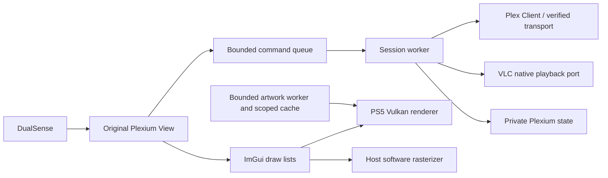

# Architecture

Plexium is an independent C++17 application with a new history. The old PlexStation main loop, media browser and ImGui UI were not imported. GPL-compatible protocol helpers and the proven low-level VLC/Vulkan/PS5 substrate were selected explicitly. No Jelly5 implementation, assets or Jellyfin protocols were copied.

Player controls are marshaled through a bounded queue onto the original render thread; worker requests receive the actual control result. A queued operation can expire before execution; an operation already executing completes before its caller proceeds. Stop captures progress before stopping video, and progress requests use a one-second timeout.

`src/app/session.*` owns credentials and selects authorized profiles, servers and sections. `Runtime` serializes commands off the render thread; snapshots contain no authorization tokens. Separate synchronized media context is consumed internally by the native artwork adapter and never serialized/logged. Profile/server changes clear old content and history. Generation changes discard obsolete queued results. Network operations themselves have bounded timeouts; cancellation is cooperative at command boundaries, not socket interruption. Home has a ten-second aggregate budget, short bounded calls, progressive row publication, duplicate-query suppression and a scoped warm cache. Movie/TV/audio sections use server-recommended hubs and 60-item browse pages.

`src/app/view.*` builds the same native draw lists in both targets, with an explicit controller focus model and a single authorized destination registry. Layout draws immediately after state changes. `src/main.cc` integrates DualSense, Vulkan, existing VLC picture upload and timestamped audio; the user reports the original candidate has a correct PS5 home icon, a generally working UI and video playback. The new update has not yet been accepted on hardware. Host rendering runs the actual view, with synthetic metadata and a software rasterizer; it cannot validate the decoder or console GPU.

`src/player.*`, `gfx.*`, platform functions, shader code and PS5 dependency recipes retain their existing licenses. Playback is deliberately limited in this checkpoint to the reused direct-play decision: single-part original H.264/HEVC MP4/MKV. Transcode negotiation, music playback, DVR and Watchlist helpers may exist in the selected protocol source but are not all wired into the new application; individual audio direct play and an experimental direct cloud-TV provider path are now integrated. Do not infer product functionality from those helpers.

Auth uses device linking, validation of the restored primary account, explicit profile selection and protected-profile PIN entry. Only the primary token persists; managed-user tokens are not silently restored past PIN selection. Per-profile server identity preferences are private files and are only selected if returned by current authorized discovery. Identity and library checks must succeed before the server is usable. HTTPS is required by default; HTTP-only personal servers are not enabled in this checkpoint.

The GPU artwork adapter uses a bounded asynchronous decoded-image cache inherited from the stabilization branch. Episode cards explicitly request `grandparent_thumb`, preserving the episode's own `id` for navigation/playback. GPU upload, native transport and artwork sources cross-compile for PS5, but are not exercised by host raster fixtures. Cache scope changes retire old textures. A driver-completion failure disables new uploads and retains uncertain allocations until process teardown.

The original UI and protocols are GPL-3.0-or-later. Future increments should add end-to-end fixture scenarios before expanding routes. Physical firmware 13.40 validation and matching native symbols remain necessary before installation acceptance.
